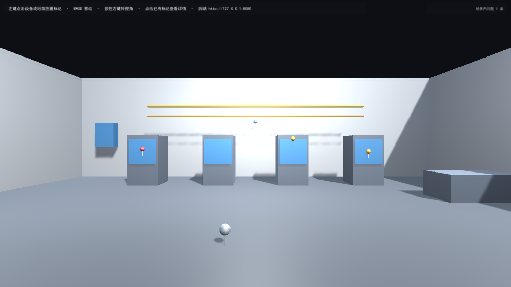

# 工业 AR 巡检 Demo（无 AR 设备备选版）

一个可运行的最小闭环：**Unity 现场巡检端** 点击设备放置问题标记并上报，**Go 后端** 落盘保存，**React 管理端** 查看并流转状态。

> 说明：本工程按「无 AR 设备备选版」实现，运行在 Unity 编辑器的普通 3D 场景中，不含 AR Foundation 运行时。第 5 节的三个 AR 基础问题以文字回答，见本文第 6 节。
>
> 题目第 7 节的演示要求里出现的「真机」字样，是 AR 真机版遗留的表述。按第 1 节「本题不要求真实 AR，也不要求使用手机，Unity Editor 或普通桌面设备可以运行即可」，本交付的演示视频在编辑器/桌面中录制。



---

## 1. 使用的版本

| 部分 | 版本 |
|---|---|
| Unity | **6000.3.15f1**（Unity 6.3 LTS），内置渲染管线，UI 用 UGUI 2.0.0 |
| Go | **1.27.3**，仅标准库，无第三方依赖 |
| Node.js | **22.22.2** |
| React | 18.3.1 + TypeScript 5.6.3 |
| Vite | 5.4.11 |

字体：`Assets/Fonts/SimHei.ttf`（从系统字体复制，用于 UGUI 中文显示；Unity 内置字体不含中文字形）。

---

## 2. 三个部分如何启动

### 2.1 Go 后端（先启动，另外两端都依赖它）

```bash
cd server
go run .          # 或先 go build -o server.exe . 再 ./server.exe
```

默认监听 `:8080`，数据落到 `server/data/problems.json`。可选参数：

```bash
go run . -addr :9000 -data data/problems.json
```

启动成功的日志：

```
[BOOT] 数据文件 data/problems.json，已加载 N 条问题
[BOOT] 服务已启动 http://127.0.0.1:8080
```

> `N` 首次启动为 0：`server/data/problems.json` 不入库，服务起来后自动创建这个文件。

自检：`curl http://127.0.0.1:8080/api/health` → `{"status":"ok","problemCount":5,...}`
单元测试：`cd server && go test ./...`

### 2.2 React 管理端

```bash
cd web
npm install
npm run dev       # http://127.0.0.1:5173
```

后端地址默认 `http://127.0.0.1:8080`（写在 `src/api.ts`）；如需改动，复制 `.env.example` 为 `.env` 并修改 `VITE_API_BASE`。

类型检查与打包：`npm run build`。

### 2.3 Unity 客户端

1. Unity Hub 用 **6000.3.15f1** 打开本工程目录；
2. 打开场景 `Assets/Scenes/Inspection.unity`；
3. 点 **Play**，场景会自动从后端拉取历史问题并恢复标记。

> 场景与 UI 全部由脚本生成，不需要手工拖拽任何引用。若场景损坏或想重来：
> 菜单 **巡检工具 → 生成巡检场景（会覆盖现有场景）**，会重建整个场景并保存。

操作方式：

| 操作 | 效果 |
|---|---|
| `W A S D` | 移动（CharacterController，不会穿墙） |
| 按住鼠标右键拖动 | 转视角 |
| 鼠标左键点击设备/地面 | 在实际命中点放置标记，并弹出上报表单 |
| 左键点击已有标记的球头 | 打开该问题的详情 |
| 表单「取消」 | 移除未保存的标记 |

**自动化自检**：进入 Play 后，菜单 **巡检工具 → 运行运行时自检**，Console 会逐条打印 23 项断言结果（当前实测 23 通过 / 0 失败）。

---

## 3. 后端地址与接口设计

Base URL：`http://127.0.0.1:8080`

| 方法 | 路径 | 说明 | 成功 |
|---|---|---|---|
| GET | `/api/health` | 健康检查，返回 `status` 与当前记录数 | 200 |
| GET | `/api/problems` | 列出全部问题，返回 `{items, total}` | 200 |
| POST | `/api/problems` | 新建问题 | **201** |
| PATCH | `/api/problems/{id}/status` | 只改状态，返回更新后的完整记录 | 200 |

### 数据字段

```json
{
  "id": "59a58d65-6fb0-4793-ab0b-e017717baa56",
  "title": "1 号机柜温度异常",
  "description": "机柜右侧温度明显偏高",
  "priority": "high",
  "status": "open",
  "position": { "x": -4.47, "y": 1.20, "z": 5.45 },
  "createdAt": "2026-10-27T07:50:54.132Z",
  "updatedAt": "2026-10-27T07:50:54.132Z"
}
```

- `id`：后端生成的 **UUID v4**，全局唯一
- `priority` 枚举：`low` / `medium` / `high`（缺省 `medium`）
- `status` 枚举：`open` / `in_progress` / `resolved`（新建固定 `open`）
- `createdAt` / `updatedAt`：ISO 8601，UTC
- `title` 上限 200 字符，`description` 上限 2000 字符，`position` 各轴须为有限值且 |v| ≤ 10000

### 错误响应

```json
{ "code": "INVALID_ARGUMENT", "message": "priority 必须是 low、medium、high 之一，收到: \"urgent\"", "field": "priority" }
```

| HTTP | code | 场景 |
|---|---|---|
| 400 | `INVALID_JSON` | 请求体不是合法 JSON，或包含未定义字段（`DisallowUnknownFields`） |
| 400 | `INVALID_ARGUMENT` | 字段校验失败，`field` 指出具体字段 |
| 404 | `NOT_FOUND` | 状态更新时 id 不存在 |

### 其他设计

- **CORS**：只放行 `http://localhost:5173`、`http://127.0.0.1:5173` 两个来源，不使用 `*`；预检请求由中间件直接返回 204。
- **持久化**：整份数据用一个 JSON 文件保存，写入方式为「临时文件 + `Sync` + 原子重命名」，进程被强杀也不会留下半截 JSON。先写盘成功再替换内存，避免「内存有、磁盘没有」的假成功。
- **并发**：读写共用一把 `sync.RWMutex`；`List` 返回切片副本，调用方无法在锁外改动内部数据。
- 每个请求打一行访问日志（方法、路径、状态码、耗时）。

---

## 4. 已完成

### 4.1 Unity 客户端（对应必做 3.1 全部 8 条）

- 场景对象：地面、后墙、侧墙、4 台机柜（柜体 + 面板 + 指示灯）、顶部管线桥架、远处设备箱，全部带 Collider
- 第一人称漫游：WASD + 右键转视角，`CharacterController` + 重力
- 射线标注：`ScreenPointToRay` + `hit.point`，标记落在**实际命中位置**；杆沿表面法线伸出，球头浮在表面外
- 表单：标题（必填、≤200 字）、描述、优先级三选一（低/中/高）、显示标记坐标、提交/取消
- 状态机：任意时刻最多一个待提交标记；再次点击只移动它，不新建；取消时立即从场景与物理查询中移除
- 上报：`UnityWebRequest` POST，成功/失败都有明确中文提示；失败时**保留标记与已填内容**，可直接重试
- UI 穿透拦截：点击输入框/按钮不会在场景里生成标记

### 4.2 React 管理端（3.2 全部）

- 列表展示标题、描述、优先级、状态、坐标、创建时间、ID
- 状态下拉直接写回后端，成功后顶部出现绿色提示条
- 统计卡片（全部 / 待处理 / 处理中 / 已解决）+ 按状态筛选
- 加载中骨架、错误提示条与「重试」按钮；后端挂掉时不白屏
- 可选 10 秒自动刷新

### 4.3 Go 后端（3.3 全部）

- 4 个接口 + 参数校验 + 唯一 ID + 默认状态 + 时间戳
- 状态可改、重启不丢、CORS 正确
- 11 个单元测试（`go test ./...` 全通过）

### 4.4 加分项（已完成 3 项）

- 从后端加载问题并恢复标记（进 Play 自动恢复，右上角显示「场景内问题 N 条」）
- 点击标记查看问题信息（标题/优先级/状态/坐标/描述）
- 按优先级改变标记样式（高=红、中=橙、低=蓝）

---

## 5. 未完成与已知问题

**未完成**

1. **两段 3～5 分钟演示视频** —— 需要真人操作界面并录屏，脚本见 `docs/演示视频分镜.md`，尚未录制。
2. 提交渠道（GitHub / Gitee / 网盘）由提交人自行创建，本仓库未预置远端。
3. 删除、编辑问题，以及按区域/设备编号筛选：本次未做（加分项，题目明确「不要求全部实现」）。
4. AR Foundation XR Simulation 未接入（第 5 节原文为「不需要编写对应功能」）。

**已知问题**

1. **标记恢复不还原表面朝向**：第 4 节的数据结构没有法线字段，后端只存坐标。因此从后端恢复的标记统一竖直立起，与首次放置时的朝向可能略有差异（坐标完全一致）。
2. **状态变更不会实时推到 Unity**：在 React 里把问题改成 `resolved` 后，Unity 里已恢复的标记颜色要重新进一次 Play 才会更新（没有做 WebSocket/轮询）。
3. **单人单机场景**：无鉴权、无多用户并发写入保护。数据文件被两个进程同时打开时后写入者覆盖前者。
4. **`position` 精度**：`float` → `double` → `float` 往返后坐标有 1e-6 量级误差，不影响验收（自检断言误差 < 1mm）。
5. **编辑器失焦时 Game View 不重绘**：这是 Unity 编辑器行为，会导致普通的截图手段拿到旧帧。工程内的 `Assets/Editor/ScreenshotUtil.cs` 用主动渲染 + `ReadPixels` 绕开，仅影响开发期截图，不影响运行和打包。
6. **中文依赖系统字体**：`Assets/Fonts/SimHei.ttf` 是从 Windows 字体目录复制的。若在其他机器上打开且该文件缺失，中文会显示为方块。字体文件已随工程提交。

---

## 6. 第 5 节：三个 AR 基础问题

### 6.1 改成真实 AR，平面检测和点击放置需要哪些 AR Foundation 能力？

- **平面检测**：`ARPlaneManager` + `ARPlane`，配合 `ARRaycastManager` 做命中测试；需要 `AROcclusionManager`（可选）让虚拟物体被真实物体遮挡。
- **点击放置**：用 `ARRaycastManager.Raycast(screenPoint, hitResults, trackableTypes)` 代替 `Physics.Raycast`。AR 里没有 Unity 的 Collider，命中结果是 `ARRaycastHit`，要取 `hit.pose.position/rotation`，而不是 `hit.point`。
- **让物体稳定停在现实位置**：把物体挂到 `ARAnchor` 下（或用 `ARAnchorManager.AttachAnchor`），不直接放在世界坐标里。
- **需要的能力清单**：`ARSession` / `ARInputManager`（会话与设备姿态）、`ARCameraManager`（相机画面）、`ARPlaneManager`（平面）、`ARRaycastManager`（命中）、`ARAnchorManager`（锚点）、`AROcclusionManager`（遮挡）、`ARPointCloudManager`（点云，可选）。

本项目里对应关系很直接：`MarkerSpawner.TryPlaceFromScreenPoint` 用 `Physics.Raycast` + `hit.point`，迁移时换成 `ARRaycastManager` + `hit.pose.position`，其余状态机、表单、上报逻辑一行不用改——这也是当初把「找位置」和「显示标记」拆成两层的原因。

### 6.2 为什么只保存 x/y/z 通常不能保证下次启动仍对应同一个真实位置？

因为 **AR 的世界坐标系不是现实世界的绝对坐标系**，它的原点由 `ARSession` 启动那一刻的设备位置和朝向决定。

- 每次启动，原点都重置到「当时的相机位姿」。同一个房间里走两步再启动一次，同一个物理点在新会话里的坐标就完全不同。
- 会话过程中还会有 **漂移（drift）**：视觉惯性里程计的累计误差、光照变化、纹理不足，都会让同一个物理点在 AR 坐标系里慢慢偏移。
- 换设备、换系统版本，坐标系之间的换算关系也不一样。

要保住「同一个真实位置」，需要把坐标绑定到 **可追踪的定位基准** 上：

1. **`ARAnchor`**：把内容锚定到某个 trackable 上，会话内稳定；
2. **持久化锚点**：`ARAnchorManager` 的持久化能力（iOS 的 ARKit Anchors / Android 的 ARCore Cloud Anchors），或 **`ARWorldMap`（ARKit）/ 云端锚点**，让「空间地图」本身被保存和重新定位；
3. **可识别的静态基准物**：二维码 / 图像标记（`ARTrackedImageManager`），先识别基准物，再把坐标换算成相对基准物的偏移——工业巡检里常见做法是在设备上贴识别标签。

反过来看本项目的实现：因为场景是固定的虚拟厂房，世界坐标本身就是稳定的，所以直接存 `x/y/z` 就能正确恢复。这正是「普通 3D」与「真实 AR」最本质的差别之一。

### 6.3 AR 初始化失败、设备不支持或 Tracking 异常时应该如何提示？

核心原则：**把状态如实、可操作地告诉用户，不要静默失败，也不要让用户以为「已经能用了」**。

- **设备不支持 / 未安装 AR 服务**：启动前用 `ARSession.state` 和平台检查（`ARCore` 是否需要安装/更新）判断，直接显示「当前设备不支持 AR，请使用支持 ARCore 的设备」并给出降级入口（例如切到普通 3D 模式）。
- **权限被拒**：明确提示需要相机权限，并给「去设置」的跳转，而不是只报一句「初始化失败」。
- **初始化失败**：显示失败原因与「重试」按钮，`ARSession` 重置后重新尝试。
- **Tracking 异常**（`ARTrackingStateLimited`）：这是最常见的一种，要区分原因讲：
  - `Reason.InsufficientLight` → 「光线太暗，请增加照明」
  - `Reason.ExcessiveMotion` → 「移动过快，请放慢」
  - `Reason.InsufficientFeatures` → 「环境特征太少，请对准有纹理的表面」
- **UI 呈现**：Tracking 受限时在屏幕上常驻一条状态条（黄），并在画面中心给出引导图形；恢复 `Tracking` 后自动消失。放置标记等操作在 `Limited` 状态下应禁用或提示「定位中，请稍候」，避免把标记放到错误位置。
- **兜底**：所有 AR 失败路径都要保证应用不崩溃、不黑屏，且能退回到可用的普通 3D 巡检模式。

---

## 7. 目录结构

```
InspectionDemo/
├─ Assets/
│  ├─ Scenes/Inspection.unity        场景（脚本生成）
│  ├─ Scripts/                       运行时脚本（8 个）
│  │  ├─ ProblemData.cs              数据模型 + 优先级/状态枚举 + JsonUtility DTO
│  │  ├─ ApiClient.cs                UnityWebRequest 封装、错误翻译、协程调度
│  │  ├─ MarkerSpawner.cs            射线 → 命中点 → 标记；UI 穿透拦截；单标记状态机
│  │  ├─ MarkerVisual.cs             标记外观：按优先级/状态上色、详情文案
│  │  ├─ InspectionUI.cs             全部 UI 交互：表单、提交、详情、toast
│  │  ├─ MarkerRestorer.cs           从后端拉取并恢复历史标记
│  │  └─ PlayerController.cs         第一人称漫游
│  ├─ Editor/                        编辑器工具（不参与打包）
│  │  ├─ SceneBuilder.cs             一键生成场景 + UI 并绑定引用
│  │  ├─ RuntimeSelfTest.cs          23 项运行时断言
│  │  ├─ ScreenshotUtil.cs           含 UI 的截图工具
│  │  └─ AutoStartMCPBridge.cs       MCP for Unity 桥接自启（开发辅助）
│  └─ Fonts/SimHei.ttf
├─ server/                           Go 后端（model / store / handlers / main + 测试）
├─ web/                              React 管理端（Vite + TS）
├─ docs/
│  ├─ 验收记录.md                    逐条验收结果与证据
│  ├─ 演示视频分镜.md                两段视频的拍摄脚本
│  └─ screenshots/                   截图证据
├─ AI_LOG.md                         AI 使用记录
└─ README.md
```

---

## 8. 验收

- 逐条验收结果与证据：**`docs/验收记录.md`**
- Unity 端可复跑的自检：Play 模式 → 菜单 **巡检工具 → 运行运行时自检**（23 项）
- 后端单测：`cd server && go test ./...`（11 个用例）
